# 3D Player Model Technical Specification & Pipeline Guide

This document defines the complete technical requirements for creating, rigging, texturing, and exporting 3D player character models that are 100% compatible with the native football game engine.

---

## 1. Engine Architecture Overview

The game engine utilizes an OpenGL ES 3.0 mobile deferred rendering pipeline with a hybrid CPU/GPU skeletal animation system:
* **Skeletal Animation**: Controlled by a canonical **13-bone hierarchy** defined in `player.object`.
* **Submesh Recognition**: The engine identifies individual body parts by parsing material and mesh names in `gltfloader.cpp` and `humanoidbase.cpp`.
* **Texture Pipeline**: Loads discrete, uncompressed/JPG/PNG diffuse textures mapped to specific body parts. 

> [!CAUTION]
> **Why Single-Mesh AI Scans (e.g., Meshy.ai) Fail**:
> Single-mesh photogrammetry models weld teeth, eyes, jersey, shorts, and limbs into one continuous watertight mesh. In this engine:
> 1. The engine cannot apply kit swapping, hair swapping, or skin-color shading to a single mesh.
> 2. Android GLES cannot decode single packed multi-channel PBR textures from GLB memory, resulting in fallback to mismatched textures (`alnassr_cr7.png`).
> 3. Vertex skinning causes chest and torso vertices to deform with arm bones, producing "bat-wing" webbing and looped limbs.

---

## 2. Modular Submesh Architecture

All player models must consist of **discrete modular submeshes** (separate Blender objects) exported together under the main armature.

```mermaid
graph TD
    PlayerArmature["PlayerArmature (Root)"]
    PlayerArmature --> Mesh_Head_Face["Mesh_Head_Face (Head, Face, Hair)"]
    PlayerArmature --> Mesh_LeftEye["Mesh_LeftEye (Left Eyeball)"]
    PlayerArmature --> Mesh_RightEye["Mesh_RightEye (Right Eyeball)"]
    PlayerArmature --> Mesh_TeethUpper["Mesh_TeethUpper (Upper Teeth/Mouth)"]
    PlayerArmature --> Mesh_TeethLower["Mesh_TeethLower (Lower Teeth)"]
    PlayerArmature --> Mesh_Shirt_Jersey["Mesh_Shirt_Jersey (Top Jersey)"]
    PlayerArmature --> Mesh_Shorts["Mesh_Shorts (Bottom Shorts)"]
    PlayerArmature --> Mesh_Boots_Socks["Mesh_Boots_Socks (Cleats & Socks)"]
    PlayerArmature --> Mesh_Skin_Body["Mesh_Skin_Body (Arms, Legs, Neck)"]
```



### Submesh Specifications & Keywords

The engine matches submeshes using lowercase substring checks in `gltfloader.cpp`:

| Submesh Object Name | Required Name Keyword | Material Keyword | Purpose & Shader Settings |
| :--- | :--- | :--- | :--- |
| `Mesh_Head_Face` | `face` or `head` | `head` / `face` | 3D face scan, facial hair, and hairstyle. Specular: `0.03`, Shininess: `0.12`. |
| `Mesh_LeftEye` | `eye` | `eye` | Left eyeball sphere. Specular: `0.08`, Shininess: `0.30`. |
| `Mesh_RightEye` | `eye` | `eye` | Right eyeball sphere. Specular: `0.08`, Shininess: `0.30`. |
| `Mesh_TeethUpper` | `teeth` or `tooth` | `teeth` | Upper teeth and gums. Specular: `0.05`, Shininess: `0.20`. |
| `Mesh_TeethLower` | `teeth` or `tooth` | `teeth` | Lower teeth and gums. Specular: `0.05`, Shininess: `0.20`. |
| `Mesh_Shirt_Jersey` | `shirt`, `top`, or `jersey`| `shirt` / `jersey` | Jersey/shirt geometry. Swappable team kit diffuse map. Specular: `0.01`, Shininess: `0.05`. |
| `Mesh_Shorts` | `short` or `bottom` | `short` / `bottom` | Shorts geometry. Swappable shorts diffuse map. Specular: `0.01`, Shininess: `0.05`. |
| `Mesh_Boots_Socks` | `shoe` or `boot` | `shoe` / `boot` | Cleats, studs, and socks. Specular: `0.05`, Shininess: `0.20`. |
| `Mesh_Skin_Body` | `skin` or `body` | `skin` / `body` | Exposed skin (arms, neck, legs). Specular: `0.02`, Shininess: `0.12`. |

---

## 3. Canonical 13-Bone Engine Skeleton

The model's armature must be named `PlayerArmature` and contain exactly the following 13 bones with exact parent-child relationships:

```
body (Pelvis / Root)
├── middle (Spine & Torso)
│   ├── neck (Head & Face)
│   ├── left_shoulder
│   │   └── left_elbow (Forearm & Hand)
│   └── right_shoulder
│       └── right_elbow (Forearm & Hand)
├── left_thigh
│   └── left_knee
│       └── left_ankle (Foot & Cleat)
└── right_thigh
    └── right_knee
        └── right_ankle (Foot & Cleat)
```

### Exact Joint Rest Coordinates (`player.object`)

All coordinates are in meters in Blender coordinate space ($X$ = right, $Y$ = forward/back, $Z$ = up):

| Joint Name | Head $(X, Y, Z)$ | Tail $(X, Y, Z)$ | Parent |
| :--- | :--- | :--- | :--- |
| `body` | `( 0.000,  0.000, 0.960)` | `( 0.000,  0.000, 1.110)` | *None (Root)* |
| `middle` | `( 0.000,  0.000, 1.110)` | `( 0.000, -0.030, 1.610)` | `body` |
| `neck` | `( 0.000, -0.030, 1.610)` | `( 0.000, -0.030, 1.880)` | `middle` |
| `left_shoulder` | `( 0.160, -0.010, 1.590)` | `( 0.150, -0.010, 1.260)` | `middle` |
| `left_elbow` | `( 0.150, -0.010, 1.260)` | `( 0.150, -0.010, 0.950)` | `left_shoulder` |
| `right_shoulder`| `(-0.160, -0.010, 1.590)` | `(-0.150, -0.010, 1.260)` | `middle` |
| `right_elbow` | `(-0.150, -0.010, 1.260)` | `(-0.150, -0.010, 0.950)` | `right_shoulder` |
| `left_thigh` | `( 0.087,  0.000, 0.950)` | `( 0.087,  0.000, 0.530)` | `body` |
| `left_knee` | `( 0.087,  0.000, 0.530)` | `( 0.087, -0.040, 0.090)` | `left_thigh` |
| `left_ankle` | `( 0.087, -0.040, 0.090)` | `( 0.087, -0.180, 0.020)` | `left_knee` |
| `right_thigh` | `(-0.087,  0.000, 0.950)` | `(-0.087,  0.000, 0.530)` | `body` |
| `right_knee` | `(-0.087,  0.000, 0.530)` | `(-0.087, -0.040, 0.090)` | `right_thigh` |
| `right_ankle` | `(-0.087, -0.040, 0.090)` | `(-0.087, -0.180, 0.020)` | `right_knee` |

---

## 4. Rest Pose & Geometry Calibration Rules

Before binding or exporting, the character geometry must be baked into the engine's canonical rest pose:

1. **Player Height Calibration**:
   * Character total height ($Z_{\max} - Z_{\min}$) must equal **`1.920m`** (`defaultPlayerHeight`).
   * Scale the mesh uniformly: $\text{scale} = \frac{1.920}{Z_{\max} - Z_{\min}}$.
2. **Ground Contact ($Z = 0.000$)**:
   * The lowest point of the cleats/studs must sit precisely at **$Z = 0.000\text{m}$**.
   * Shift all vertices along $Z$ so $Z_{\min} = 0.000\text{m}$.
3. **Lateral Centering ($X = 0.000$)**:
   * Mesh must be centered on the sagittal plane: $\frac{X_{\min} + X_{\max}}{2} = 0.000\text{m}$.
4. **Arm Rest Pose (Vertical Hang)**:
   * Arms must hang vertically straight down along the sides of the torso (I-pose).
   * **Target bounds**: Hand tips must sit near $X \approx \pm 0.18\text{m}$ to $\pm 0.22\text{m}$.
   * **Do NOT use a wide A-pose ($45^\circ$) or T-pose ($90^\circ$)** as rest geometry.
5. **Leg Stance (Parallel)**:
   * Left and right legs must be vertical and parallel to each other.
   * Cleats must be separated by approximately $17\text{cm}$ ($X_{\text{left\_ankle}} \approx +0.087\text{m}$, $X_{\text{right\_ankle}} \approx -0.087\text{m}$).

---

## 5. Vertex Weighting & Skinning Rules

Each vertex in each submesh must have weights assigned only to valid anatomical bones:

* **Torso Isolation**:
  * `Mesh_Shirt_Jersey` and torso skin vertices ($|X| \le 0.16\text{m}$, $0.95\text{m} \le Z \le 1.55\text{m}$) must have **`0.000`** weight for `left_shoulder`, `left_elbow`, `right_shoulder`, and `right_elbow`.
  * Torso vertices must be weighted 100% to `middle` and `body`.
* **Clavicle Lock**:
  * Clavicles must be collapsed into `middle` (torso) to prevent shoulder "horn" mutations.
* **Forearm / Elbow Isolation**:
  * Forearm and hand vertices must be weighted exclusively to `left_elbow` or `right_elbow`.
  * Elbow bones must not have weights above $Z = 1.28\text{m}$ or on the torso ($|X| < 0.15\text{m}$).
* **Normalization**:
  * The sum of weights for any vertex across all bones must equal exactly $1.000$: $\sum_{i} w_i = 1.0$.

---

## 6. Texture & Material Rules

The mobile renderer does not use full PBR metallic/roughness workflows:

* **File Format**: Standard 24-bit RGB or 32-bit RGBA `.jpg` or `.png`.
* **Resolution**: $1024 \times 1024$ or $2048 \times 2048$ square textures.
* **Material Settings in Blender**:
  * Shading Node: Standard `Principled BSDF`.
  * **Metallic**: Set to `0.000` (non-metallic).
  * **Roughness**: Set to `0.800` - `0.900` (fabric/skin matte finish).
  * **Normal Map**: Do not pack tangent-space normal map nodes into the GLB for mobile release unless explicitly supported; diffuse color map is primary.
* **Separate Image Files**:
  * Rather than packing textures into GLB binary blobs, keep discrete image files in `media/objects/players/textures/<player_name>/` so the engine can load them directly from disk.

---

## 7. Model Creation & Sourcing Workflows

### Option A: EA Sports FC Mobile / FIFA Rips (Recommended)
1. Source extracted 3D player models from reputable modding archives (e.g., FIFA Infinity, SoccerGaming, RenderZ).
2. The rip will contain the original 10 modular submeshes, professional 72-bone vertex weights, and dedicated texture maps.
3. Run the automated script [`tools/build_exact_yamal_engine.py`](file:///e:/MY-PROJECTS/android%20native%20football/tools/build_exact_yamal_engine.py) (replacing the source file path).
4. The script poses arms/legs, collapses the 72 bones to 13, scales to 1.92m, and exports the clean `fullbody.glb`.

### Option B: Custom Character Modeling (Blender / Mixamo / CC4)
1. Model the head/hair, shirt, shorts, and cleats as **separate mesh objects**.
2. Rig the model using a standard humanoid skeleton with arms hanging down.
3. Ensure no vertices on the shirt/shorts have weights assigned to the arm bones.
4. Name each object and material according to the keyword table in Section 2.
5. Export to GLB with options:
   * `Export Format`: GLB
   * `Include`: Selected Objects (`PlayerArmature` + submeshes)
   * `Geometry -> Apply Modifiers`: False (keep Armature modifier active)
   * `Animation -> Skins`: True
   * `Animation -> Shape Keys`: False

---

## 8. Export Targets Checklist

When generating a production player model, export to all three engine paths:

1. `assets/media/objects/players/models/fullbody.glb` (source asset directory)
2. `platform/android/app/src/main/assets/media/objects/players/models/fullbody.glb` (Android APK package asset directory)
3. `tools/workbench/universal_player_engine_13b.glb` (workbench reference)

Then run `platform\android\build_fast_release.bat` to compile the release APK.
