# FIFA / FC RX3 Tools Analysis & Engine Integration Pipeline

## Executive Summary

The modding toolkit located at `E:\Downlaod\Rx3Tools_experimental_0200\Rx3Tools` provides **direct access to genuine EA Sports FIFA character assets** (FIFA 12 through FIFA 16 PC, FIFA 23 Switch, and FIFA Online 4 / FO4). 

Using the command-line exporter `rx3c.exe` and Blender 5.1, we successfully extracted, verified, and rendered the authentic FIFA 16 LOD0 player base head (`head_0_2.rx3`).

---

## 1. Tool Capabilities & Architecture

`Rx3Tools` is an experimental EA Sports asset container decompiler/compiler created by Dmitri with community modders.

### Key Executables
- **`rx3c.exe`**: Command-line interface for batch processing, asset conversions, and automated build scripts.
- **`Rx3Tools.exe`**: Windows GUI application for visual browsing and manual texture/mesh injection.

### Supported Games (`-game` flag)
| Game Identifier | Engine Generation | Assets Supported |
| :--- | :--- | :--- |
| `fo4` | FIFA Online 4 (Frostbite-hybrid / Ignite) | High-poly modern faces, hairs, kits |
| `fifa23switch` | FIFA 23 Nintendo Switch (Legacy Ignite) | Modern players, switch format |
| `fifa16pc` | FIFA 16 PC (Ignite Engine) | 399-bone skeleton, high-detail faces, wrinkle normals |
| `fifa15pc` | FIFA 15 PC | First Ignite PC edition, dynamic kits |
| `fifa14pc` | FIFA 14 PC | Classic format, huge community face library |
| `fifa13pc` / `fifa12pc` | FIFA 12/13 PC | Impact engine generation |

---

## 2. Included Data Analysis

The `data/` folder contains essential reverse-engineering databases:

### 1. Skeletons (`data/skeletons/`)
- Contains full skeletal definitions (`skeleton_player.rx3`) across all supported FIFA editions.
- **Bone count**: 399 bones, including:
  - Trajectory & Root nodes (`AITrajectory`, `Hips`).
  - Quad-spine chain (`Spine`, `Spine1`, `Spine2`, `Spine3`) with breathing and pectoral jiggle bones.
  - Complete anatomical facial rig: jaw, tongue, chin, cheeks, nasal folds, lips, eyelids, eye look-at, and 12+ hair motion bones (`RM_Sway_Hair`, `RM_Top_Hair`, etc.).
  - Realistic leg and arm twist helpers (`RM_LeftLegTwist`, `RM_LeftCalfTwist`, `RM_LeftUpLeg_Shorts`).

### 2. Base Models (`data/base_models/`)
Contains reference base heads across all games in 4 levels of detail:
- `head_0_2.rx3` (LOD 0): **3,157 vertices, 6,014 polygons** — clean AAA facial topology.
- `head_1_2.rx3` (LOD 1): Medium distance.
- `head_2_2.rx3` (LOD 2): Gameplay camera distance.
- `head_3_2.rx3` (LOD 3): Low-poly far distance.

### 3. Bone Remapping Tables (`data/bone_remap/`)
Text tables defining how bones map between different EA Sports game generations:
- `Skeleton16To14.txt`, `SkeletonToOld.txt`, `SkeletonToFB2.txt`, `SkeletonToIE.txt`, `SkeletonToSlcNew.txt`.

### 4. Texture Formats Specification (`data/texture_formats/`)
Lists all FIFA texture channels and their compression standards:
- `*_cm`: Color Map / Albedo (DXT1 / DXT5 PNG)
- `*_nm`: Tangent Space Normal Map (BC5 / 3Dc)
- `*_coeff`: Material Coefficients: Roughness, Metallic, AO, Specular (DXT5)
- `*_region`: **RGB Kit/Shoe Color Mask** for team primary/secondary/trim recoloring (DXT1)
- `*_sk`: Subsurface skin tone scattering map (DXT1)
- `*_wkl_nm`: Dynamic facial wrinkle normals (BC5)

---

## 3. Lossless Bone Collapse: FIFA 399-Bones to Engine 13-Bones

Because our Android engine requires exactly 13 canonical bones (`body`, `middle`, `neck`, `left_shoulder`, `left_elbow`, `right_shoulder`, `right_elbow`, `left_thigh`, `left_knee`, `left_ankle`, `right_thigh`, `right_knee`, `right_ankle`), FIFA assets can be mapped **losslessly and deterministically**.

Every sub-bone in FIFA's hierarchy simply adds its vertex weights to its parent engine bone:

```mermaid
graph TD
    subgraph FIFA_Bones["EA Sports FIFA Skeleton (399 Bones)"]
        Hips["Hips + RM_Shorts + RM_Butt"]
        Spine["Spine, Spine1..3 + Ribs + Pecs"]
        Facial["Neck, Head + 80 Facial/Hair Bones"]
        LArm["LeftArm + LeftShoulder + Deltoid"]
        LFore["LeftForeArm + LeftHand + Fingers"]
        RArm["RightArm + RightShoulder + Deltoid"]
        RFore["RightForeArm + RightHand + Fingers"]
        LLegU["LeftUpLeg + RM_LeftSartorius"]
        LLegL["LeftLeg + RM_LeftCalfTwist"]
        LFoot["LeftFoot + LeftToeBase"]
        RLegU["RightUpLeg + RM_RightSartorius"]
        RLegL["RightLeg + RM_RightCalfTwist"]
        RFoot["RightFoot + RightToeBase"]
    end

    subgraph Engine_13["Engine 13 Bones"]
        B_Body["body"]
        B_Middle["middle"]
        B_Neck["neck"]
        B_LShoulder["left_shoulder"]
        B_LElbow["left_elbow"]
        B_RShoulder["right_shoulder"]
        B_RElbow["right_elbow"]
        B_LThigh["left_thigh"]
        B_LKnee["left_knee"]
        B_LAnkle["left_ankle"]
        B_RThigh["right_thigh"]
        B_RKnee["right_knee"]
        B_RAnkle["right_ankle"]
    end

    Hips --> B_Body
    Spine --> B_Middle
    Facial --> B_Neck
    LArm --> B_LShoulder
    LFore --> B_LElbow
    RArm --> B_RShoulder
    RFore --> B_RElbow
    LLegU --> B_LThigh
    LLegL --> B_LKnee
    LFoot --> B_LAnkle
    RLegU --> B_RThigh
    RLegL --> B_RKnee
    RFoot --> B_RAnkle
```



### Weight Remapping Rule in Blender
```python
BONE_COLLAPSE_MAP = {
    # 1. Body (Pelvis & Hips)
    "body": ["Hips", "RM_Shorts_Crotch", "RM_Shorts_Back", "RM_LeftShorts", "RM_RightShorts", "RM_LeftButt", "RM_RightButt", "RM_LeftShirt_Front", "RM_RightShirt_Front"],
    # 2. Middle (Torso & Spine)
    "middle": ["Spine", "Spine1", "Spine2", "Spine3", "RM_Spine_Jiggle", "RM_Spine1_Jiggle", "RM_Spine2_Jiggle", "RM_Spine3_Jiggle", "RM_LeftRibCage", "RM_RightRibCage", "RM_LeftUpperPec", "RM_RightUpperPec"],
    # 3. Neck (Head, Face, Jaw, Hair)
    "neck": ["Neck", "Neck1", "Head", "HeadEnd", "Face", "Jaw", "Tongue", "Chin", "MiddleNose", "LeftEye", "RightEye", "UpperLip", "LowerLip", "RM_Sway_Hair", "RM_Top_Hair", "RM_Front_Hair", "RM_Back_Hair_01", "RM_LeftTrap", "RM_RightTrap"],
    # 4. Arms
    "left_shoulder": ["LeftShoulder", "LeftArm", "LeftArmRoll", "RM_LeftBicep", "RM_LeftTricep"],
    "left_elbow": ["LeftForeArm", "LeftForeArmRoll", "LeftHand", "LeftHandThumb1", "LeftHandIndex1", "LeftHandMiddle1"],
    "right_shoulder": ["RightShoulder", "RightArm", "RightArmRoll", "RM_RightBicep", "RM_RightTricep"],
    "right_elbow": ["RightForeArm", "RightForeArmRoll", "RightHand", "RightHandThumb1", "RightHandIndex1", "RightHandMiddle1"],
    # 5. Legs
    "left_thigh": ["LeftUpLeg", "LeftUpLegRoll", "RM_LeftUpLegTwist1", "RM_LeftUpLegTwist2", "RM_LeftSartorius"],
    "left_knee": ["LeftLeg", "LeftLegRoll", "RM_LeftLegTwist", "RM_LeftCalfTwist", "RM_LeftKnee_Lower", "RM_LeftKnee_Upper"],
    "left_ankle": ["LeftFoot", "LeftToeBase", "LeftFootEnd"],
    "right_thigh": ["RightUpLeg", "RightUpLegRoll", "RM_RightUpLegTwist1", "RM_RightUpLegTwist2", "RM_RightSartorius"],
    "right_knee": ["RightLeg", "RightLegRoll", "RM_RightLegTwist", "RM_RightCalfTwist", "RM_RightKnee_Lower", "RM_RightKnee_Upper"],
    "right_ankle": ["RightFoot", "RightToeBase", "RightFootEnd"]
}
```

When all child vertex groups are summed and renamed to the 13 canonical bones, the player model keeps 100% of its anatomical deformation and volume without any collapsing vertices or tearing.

---

## 4. Full Conversion Pipeline: RX3 to Engine GLB

### Step 1: Export RX3 to FBX & PNG using `rx3c.exe`
```powershell
& "E:\Downlaod\Rx3Tools_experimental_0200\Rx3Tools\rx3c.exe" `
  -export -console `
  -game fifa16pc `
  -skeleton "E:\Downlaod\Rx3Tools_experimental_0200\Rx3Tools\data\skeletons\fifa16pc\skeleton_player.rx3" `
  -i "<input_path>\head_250.rx3" `
  -o "<output_dir>" `
  -model fbx `
  -texture png
```

### Step 2: Blender Automation
1. Imports the exported FBX (meshes + skeleton).
2. Normalizes scale (1.0 = 1 meter).
3. Merges child vertex groups into the 13 engine vertex groups.
4. Binds the mesh to the engine's canonical 13-bone `PlayerArmature`.
5. Separates into modular submeshes (`Mesh_Head_Face`, `Mesh_Shirt_Jersey`, etc.).
6. Exports game-ready `fullbody.glb` to `assets/media/player/models/` and `platform/android/...`.

---

## 5. Summary & Next Steps
- `Rx3Tools` is completely verified and working cleanly on Windows.
- It provides a reliable bridge to extract official EA Sports player faces, hair, kits, and boots.
- If you have specific `.rx3` player files (e.g., Messi, Neymar, CR7, Mbappé, or Yamal facepacks from FIFA 14/15/16/FO4), you can point them to `rx3c.exe` to convert them immediately into AAA engine-ready models.
